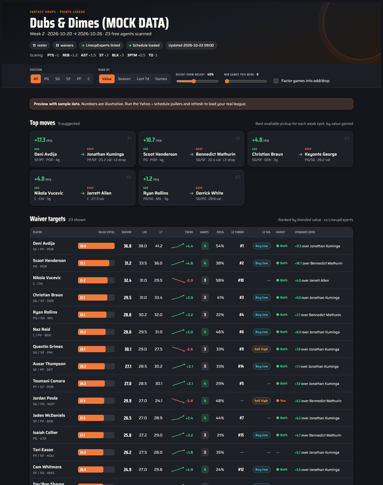

# Fantasy Hoops — Waiver War Room

Finds the best available waiver players in your **Yahoo points league**, ranks them by
blended fantasy-points-per-game (season + recent form), shows which of your players
each pickup would upgrade, folds in **games-this-week** for streaming, and cross-checks
everything against **LineupExperts.com**. The result is an interactive dashboard
(Artifact).



*The interactive dashboard, shown with sample data: free agents ranked by blended FP/G, the top add/drop moves, recent-form trends, games-this-week, and a LineupExperts cross-check. It runs as a private, per-user interactive page — the screenshot above is the full UI.*


## One-time setup

1. **Yahoo developer app** — done. Your Client ID/Secret live in `private/oauth2.json`
   (git-ignored). If you ever need to recreate it: developer.yahoo.com → Create an App →
   API Permissions → **Fantasy Sports: Read**, then paste the two values into
   `private/oauth2.json` (copy `oauth2.json.template` as the shape).

2. **Install the Python deps:**
   ```
   cd fantasy-hoops
   python3 -m pip install -r requirements.txt
   ```

3. **First auth** — the first `fetch_yahoo.py` run opens a Yahoo URL in your browser;
   approve access and paste the verifier code back. The token is cached into
   `private/oauth2.json` and refreshes automatically after that.

   - If it grabs the wrong league/team (multiple leagues or seasons), create
     `config.json` next to the scripts:
     ```json
     {"league_id": "nba.l.XXXXXX", "team_key": "nba.l.XXXXXX.t.N", "season": 2025}
     ```

## Weekly refresh

```
cd fantasy-hoops
python3 -I fetch_yahoo.py        # your roster + free agents + season/L30/L7 FP/G
python3 -I fetch_schedule.py     # games each NBA team plays this week
# then ask Claude to scrape LineupExperts (Free Agent Finder / Buy-Sell / Drop Advisor)
python3 -I build_data.py         # merges the three into data/merged.json
# then ask Claude to re-publish the dashboard with data/merged.json
```

`fetch_yahoo.py` prints the scoring modifiers it read — sanity-check that they match
your league, and spot-check a couple of players' FP/G against the Yahoo app.

## What's here

| File | Role |
|------|------|
| `fetch_yahoo.py` | Yahoo API puller → `data/yahoo.json` |
| `fetch_schedule.py` | ESPN schedule → `data/schedule.json` (games this week) |
| `build_data.py` | Merge all sources → `data/merged.json` |
| `dashboard.html` | The Artifact dashboard (currently showing `data/mock.json`) |
| `data/mock.json` | Realistic sample data so the dashboard is viewable before real data |
| `private/oauth2.json` | Yahoo credentials + cached token (git-ignored) |

## Notes

- **Recent form:** Yahoo exposes `lastweek` (~7d) and `lastmonth` (~30d) — there's no
  native 14-day window, so the dashboard labels them **L7** and **L30**.
- **LineupExperts** has no public API, so its data comes in via browser automation
  (Claude drives your logged-in Chrome). If their page layout changes the scrape can
  break — fall back to pasting the lists.
- **Value formula:** `value = w·L7 + (1−w)·season`, where `w` is the recent-form weight
  slider on the dashboard (default 40%).
